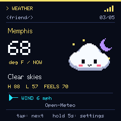
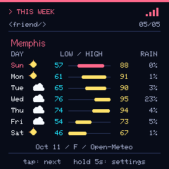

# DeskBuddy

A tiny, colorful desk companion built on a repurposed NM-TV-154 ESP32 display. **DeskBuddy is a working name.**

Version **0.6.0** adds corrected panel colors, animated weather artwork, a seven-day forecast, avatar rotation on each Companion visit, and a phone remote that works while the display stays active. Settings live in a phone dashboard on your local network.





## Use it

- **Tap** the top to advance to the next selected page.
- **Hold one second** to return to the first page.
- **Hold five seconds** to open the phone dashboard. Join the same Wi-Fi, open the address on the screen, and enter its six-digit code.
- Leave the top untouched for two seconds at startup so touch can calibrate.

First setup uses the temporary Wi-Fi name and password shown on screen. Join it, stay connected through the phone's “no internet” warning, then open **http://192.168.4.1** and connect to your 2.4 GHz home Wi-Fi.

See the [field guide](docs/field-guide.md) for setup, controls, updates, and troubleshooting, and the [maintainer guide](docs/maintenance.md) for building and hardware details.

## Included

| Page | What it does |
| --- | --- |
| Companion | Choose Weather Cloud, Paperclip, Hacker Dolphin, Money Sun, Mr. Meeseeks, Pokémon Parade, or Joe Camel. |
| Clock | Internet time, seven timezone choices, and 12/24-hour display. |
| Weather | City search, temperature and conditions, Fahrenheit/Celsius, and labeled cached readings. |
| This Week | Seven daily weather icons, high/low ranges, and precipitation chance. |
| Wi-Fi Signal | Signal strength, four bars, quality label, and about 45 seconds of history. |

Weather Cloud changes with the selected city's conditions. Every character has two animation frames. The dashboard preview is static. You can rename the device, arrange or disable five pages, set automatic page switching, and cycle avatars on each visit. Phone controls include Previous, Home, Next, direct page selection, and pause/resume.

## Build and check

Toolchain used for 0.6.0: Arduino CLI 1.5.1, Arduino-ESP32 3.3.11, and TFT_eSPI 2.5.43. Put Arduino CLI on PATH; install the pinned core and library as described in the [maintainer guide](docs/maintenance.md).

```powershell
.\build.ps1 -Jobs 2
node tests/dashboard.cjs
python art/build_avatars.py
```

The build script supplies the required display configuration and partition scheme. Opening the sketch in an unconfigured Arduino IDE is insufficient. The artwork command regenerates the packed sprites, matching dashboard previews, and preview PNGs.

## Project layout

- `DeskBuddy/` — firmware, dashboard, display settings, and public verification key.
- `art/` — code-native pixel artwork generator; Python standard library only.
- `tests/` — dashboard behavior checks using a simulated browser environment.
- `docs/` — field guide, maintenance, roadmap, source hashes, and versioned validation summaries.
- `previews/` — character lineup.
- `build.ps1` and `sign-update.cjs` — build and signed-update tools.

This repository starts with the source used by the device-tested 0.5.0 build. Compiled firmware packages, private signing material, configured flash dumps, and local logs are excluded. The existing packaged release is retained locally; this initial repository import does not publish a GitHub binary release.

## Status and attribution

The 0.5.0 build was installed and checked on the target hardware. The current changes and validation are tracked in [0.6.0 notes](docs/validation-0.6.0.md); the [0.5.0 validation](docs/validation-0.5.0.md) remains as history. Naming remains open and countdown is deferred; future app ideas are tracked in the [roadmap](docs/roadmap.md).

Weather data: [Open-Meteo](https://open-meteo.com/), with CC BY 4.0 attribution. Display library: [TFT_eSPI](https://github.com/Bodmer/TFT_eSPI), whose [license is included](TFT_eSPI-license.txt). Hardware reference: [NM-TV-154](https://github.com/RockBase-iot/NM-TV-154).

No project-wide license has been selected. Character names and recognizable designs reference their respective owners; no ownership of those characters is claimed.
