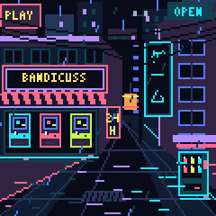

# 0.7.0 validation

Installed and checked on the second NM-TV-154 on November 2, 2026. Its hardware identity was confirmed as distinct from the original unit before any flash writes. The original unit was not flashed.

## Changes and build

Neon Arcade artwork page (ID 5), six-page navigation, a draft-only Bandicuss preset, neutral device wording, explicit v0.6 settings migration, and a clean gift settings generator. Companion remains enabled by the preset. One application binary serves all profiles.

The build passed: **1,412,761 program bytes** (71% of the 1,966,080-byte slot), **55,572 bytes of static RAM**. All 25 compiler source files match the repository's recorded source hashes. The signed package was generated with the existing trusted release key.

Dashboard checks passed for six pages, preset draft behavior, explicit Save, preservation of avatar/mode/colors/location/time/units, and remote selection of Neon Arcade. The preset does not submit Wi-Fi credentials. The clean settings generator's explicit preference overrides were also checked using synthetic data.

## Hardware checks

- Startup self-tests and startup confirmation passed.
- A synthetic v0.6 settings record migrated in actual flash: name, location, clock, avatar/mode, color profile, page order and rotation were preserved. Neon Arcade stayed disabled and the old record remained available.
- The initial clean gift settings image was verified byte-for-byte. Offline artwork, all six page transitions, and Home returning to Neon Arcade passed.
- The owner confirmed the upright animated scene, yellow Bandicuss sign, and tap/hold controls after the requested power reconnect. Actual framebuffer captures were reviewed, including an 18-character name fitting inside the sign.
- Authenticated remote home/next/previous/direct-page and pause/resume passed. Unauthorized calls, malformed/duplicate page orders, and navigation to a disabled artwork page were rejected.
- All seven character selections and per-visit avatar wrap passed. Settings and the network connection survived restart.
- A simulated 20-second Wi-Fi outage recovered; artwork continued to work. Live clock synchronization, current weather, and seven daily forecasts passed.

## Continuous observation

**1,800 seconds**, **1,775 status samples**, all six pages observed, **zero restarts**, and no status gap exceeding five seconds. The run began offline and continued online after phone setup (1,377 online samples). Minimum sampled free heap was **78,564 bytes**. This was passive serial observation during use, not a claim of exhaustive stress testing or long-term reliability.

## Handoff and package

The owner asked to retain the saved Wi-Fi connection. The final unit also retains the phone-selected avatar cycling, two-minute page switching, weather city, clock, and colors, with Neon Arcade first and Companion second. The chosen order places This Week before Wi-Fi Signal. These are customized saved settings; the reusable Bandicuss preset still loads its documented defaults.

Temporary test/cache history was removed while preserving the current application and network records byte-for-byte. Credential-bearing data stayed in memory and was neither printed nor exported. A final reboot verified reconnection, retained preferences, fresh selected-city weather, and the Neon Arcade home page. The dashboard was closed afterward.

The downloadable package is separate from the configured device: its generic merged image has blank NVS, and its optional Bandicuss settings image contains no network or weather cache. The signed payload matches the application; private signing material and configured flash dumps are excluded.

This release was installed by USB on the gift unit. The unchanged OTA engine's full tamper/interruption/rollback matrix was not repeated, and this first-install unit has no older custom firmware image in the recovery slot.

